# 🎬 Content-Based & Dynamic Hybrid Movie Recommendation Engine

[](https://www.python.org/)
[](https://scikit-learn.org/)
[](https://pandas.pydata.org/)
[](https://www.nltk.org/)
[](https://www.themoviedb.org/)

An intelligent **Content-Based Movie Recommendation System** enhanced with a **Dynamic Fallback Hybrid Architecture**. It combines Natural Language Processing (NLP), Bag-of-Words vectorization, and vector space similarity to recommend movies based on genres, plot summaries, keywords, top cast, and directors.

---

## 📌 Table of Contents
1. [Key Highlights](#-key-highlights)
2. [System Architecture](#-system-architecture)
3. [How the Dual-Layer Recommendation Works](#-how-the-dual-layer-recommendation-works)
4. [Mathematical & Algorithmic Foundation](#-mathematical--algorithmic-foundation)
5. [Project Structure](#-project-structure)
6. [Datasets Used](#-datasets-used)
7. [Installation & Setup](#-installation--setup)
8. [Usage Guide](#-usage-guide)
9. [Generated Model Artifacts](#-generated-model-artifacts)
10. [Configuration & API Key](#-configuration--api-key)

---

## 🌟 Key Highlights

- **Dual-Layer Hybrid Recommender:**
  - **Local Layer:** Ultra-fast offline inference using precomputed cosine similarities across 4,800+ movies in the TMDB 5,000 dataset.
  - **Live Online Fallback:** If a user queries a movie not present in the local database, the system queries the live **TMDB REST API**, reconstructs tags in real-time, maps the title into the trained 5,000-dimensional vocabulary space, and computes cosine similarities against the entire local catalogue.
- **Fuzzy String Matching:** Tolerates spelling mistakes, typos, and partial input using Gestalt pattern matching (`difflib`) with a 0.6 similarity cutoff.
- **Robust Feature Engineering:**
  - Entity whitespace collapsing (e.g., `"Sam Worthington"` $\rightarrow$ `"SamWorthington"`) to avoid token collisions between people sharing first or last names.
  - Morphological stem reduction via the **Porter Stemming Algorithm** (e.g., `"activities"`, `"activity"` $\rightarrow$ `"activ"`).

---

## 📐 System Architecture

```mermaid
flowchart TD
    subgraph Data_Preparation ["1. Data Preprocessing & Vectorization (Offline)"]
        A[tmdb_5000_movies.csv] & B[tmdb_5000_credits.csv] --> C[Merge on Title & Clean JSON Fields]
        C --> D[Feature Engineering: genres, keywords, cast, crew, overview]
        D --> E[Entity Space Collapsing & Porter Stemming]
        E --> F[Combined 'tags' Corpus]
        F --> G[CountVectorizer: 5000 max features]
        G --> H[(new_df.pkl)]
        G --> I[(cv.pkl)]
        G --> J[(vector.pkl)]
        J --> K[Cosine Similarity Matrix]
        K --> L[(similarity.pkl)]
    end

    subgraph Inference ["2. Runtime Dual-Layer Query Flow"]
        M([User Input: Movie Title]) --> N{Fuzzy Match in Local Catalogue?\ndifflib cutoff >= 0.6}
        
        N -- Yes --> O[Retrieve Index in new_df]
        O --> P[Query Precomputed similarity.pkl Matrix]
        P --> Q[Sort Top 5 Nearest Neighbors]
        
        N -- No --> R[TMDB v3 API Fallback]
        R --> S[Fetch Overview, Genres, Cast & Director]
        S --> T[Construct Real-time Tags & Apply Porter Stemmer]
        T --> U[Project into Learned Space via cv.transform]
        U --> V[Compute Cosine Similarity against vector.pkl]
        V --> Q
        
        Q --> W([Final Top 5 Movie Recommendations])
    end
```



---

## ⚙️ How the Dual-Layer Recommendation Works

### 1. Local Offline Engine
- Matches user queries against local movie titles using `difflib.get_close_matches`.
- Looks up the row index in the precomputed pairwise cosine similarity matrix `similarity.pkl` ($4806 \times 4806$).
- Sorts similarity scores in descending order and returns the top 5 closest movies.

### 2. Online Dynamic Fallback Engine
- When a requested movie is not in the dataset (e.g. newer or obscure titles):
  1. Calls `/3/search/movie` on the TMDB API to resolve the primary movie ID.
  2. Queries `/3/movie/{id}`, `/3/movie/{id}/keywords`, and `/3/movie/{id}/credits`.
  3. Extracts top 4 cast members, director, genres, keywords, and plot summary.
  4. Collapses entity whitespace and applies Porter stemming.
  5. Projects the live query vector into the fitted vocabulary using `cv.transform([tags])`.
  6. Computes live cosine similarities against the offline matrix `vector.pkl` ($4806 \times 5000$) and returns the top matches.

---

## 🧮 Mathematical & Algorithmic Foundation

### 1. Bag of Words (CountVectorizer)
Converts text into fixed-length numeric vectors:
- **Vocabulary Size ($D$):** 5,000 most frequent unigrams.
- **Stopwords:** English stop words (`"the"`, `"is"`, `"and"`, etc.) are eliminated.
- Produces term-frequency document matrix $\mathbf{V} \in \mathbb{R}^{N \times 5000}$, where $N = 4806$.

### 2. Cosine Similarity
Evaluates directional alignment between two movie vectors $\mathbf{u}$ and $\mathbf{v}$, invariant to document length:

$$\text{Similarity}(\mathbf{u}, \mathbf{v}) = \cos(\theta) = \frac{\mathbf{u} \cdot \mathbf{v}}{\|\mathbf{u}\|_2 \|\mathbf{v}\|_2} = \frac{\sum_{i=1}^{n} u_i v_i}{\sqrt{\sum_{i=1}^{n} u_i^2} \sqrt{\sum_{i=1}^{n} v_i^2}}$$

- Value ranges from $0$ (completely dissimilar) to $1$ (identical feature distribution).

### 3. Morphological Stemming (Porter Stemmer)
Normalizes words to their base linguistic roots via suffix-stripping rules:
$$\text{"loved"}, \text{"loving"}, \text{"loves"} \longrightarrow \text{"love"}$$

### 4. Fuzzy String Matching (Gestalt Pattern Matching)
Uses Python's `difflib.SequenceMatcher`:
$$\text{Ratio} = \frac{2 \cdot M}{T}$$
where $M$ is the number of matches in longest common subsequences and $T$ is the total character count. Queries with ratio $\ge 0.6$ are matched directly.

---

## 📁 Project Structure

```text
.
├── tmdb_5000_movies.csv      # TMDB dataset: budgets, genres, keywords, overview, revenue, etc.
├── tmdb_5000_credits.csv     # TMDB dataset: cast and crew metadata for 4,803 movies
├── movie-recom-sys.ipynb     # Phase 1 Notebook: EDA, Data cleaning, NLP pipeline & model export
├── movie-rec-hybrid.ipynb    # Phase 2 Notebook: Hybrid recommendation engine with TMDB API fallback
├── PROJECT_OVERVIEW.txt      # Detailed technical specification and architectural documentation
├── requirements.txt          # Python project dependencies
├── .gitignore                # Configured ignore rules for virtualenvs, caches, and large files
│
├── new_df.pkl                # Serialized DataFrame with clean metadata ('movie_id', 'title', 'tags')
├── cv.pkl                    # Fitted CountVectorizer vocabulary (5,000 features)
├── similarity.pkl*           # Precomputed (4806 x 4806) cosine similarity matrix (~185 MB)
└── vector.pkl*               # Dense BoW feature count matrix (4806 x 5000) (~192 MB)
```
*\*Note: Large pickle files (`similarity.pkl`, `vector.pkl`) exceed GitHub's 100MB standard push limit and can be generated locally in ~1 minute by running `movie-recom-sys.ipynb`.*

---

## 📊 Datasets Used

The project uses the [TMDB 5000 Movie Dataset](https://www.kaggle.com/datasets/tmdb/tmdb-movie-metadata):
1. **`tmdb_5000_movies.csv`** (4,803 rows, 20 columns):
   - `id`, `title`, `overview`, `genres`, `keywords`, `popularity`, `vote_average`, etc.
2. **`tmdb_5000_credits.csv`** (4,803 rows, 4 columns):
   - `movie_id`, `title`, `cast` (JSON string), `crew` (JSON string).

---

## 🚀 Installation & Setup

### 1. Clone the Repository
```bash
git clone https://github.com/MoonAcute/Movie-rec-kaggle.git
cd Movie-rec-kaggle
```

### 2. Create and Activate a Virtual Environment
```bash
# macOS / Linux:
python3 -m venv .venv
source .venv/bin/activate

# Windows:
python -m venv .venv
.venv\Scripts\activate
```

### 3. Install Dependencies
```bash
pip install -r requirements.txt
```

---

## 💻 Usage Guide

### Step 1: Model Training & Artifact Generation
Run [movie-recom-sys.ipynb](file:///Users/lain/Downloads/Movie-rec%20kaggle/movie-recom-sys.ipynb) in Jupyter Notebook or VS Code / PyCharm.
- Cleans and merges the raw CSV datasets.
- Parses JSON fields (`genres`, `keywords`, `cast`, `crew`).
- Performs stemming and vectorization.
- Generates `new_df.pkl`, `cv.pkl`, `similarity.pkl`, and `vector.pkl`.

### Step 2: Interactive Recommendations
Open and run [movie-rec-hybrid.ipynb](file:///Users/lain/Downloads/Movie-rec%20kaggle/movie-rec-hybrid.ipynb):

```python
# Query a movie in the local catalogue (supports typos):
recommend('Avatar')
recommend('Avatr')  # Fuzzy match automatically corrects to 'Avatar'

# Query a newer movie outside the dataset (triggers TMDB API fallback):
recommend('Oppenheimer')
recommend('Dune: Part Two')
```

---

## 🔑 Configuration & API Key

The hybrid engine requires a TMDB API v3 key to query fallback metadata. In [movie-rec-hybrid.ipynb](file:///Users/lain/Downloads/Movie-rec%20kaggle/movie-rec-hybrid.ipynb), update your key:

```python
TMDB_API_KEY = "YOUR_TMDB_API_KEY_HERE"
```

> **Security Tip:** For production or public repositories, avoid hardcoding keys. Use environment variables via `python-dotenv`:
> ```python
> import os
> TMDB_API_KEY = os.getenv("TMDB_API_KEY")
> ```

---

## 📦 Generated Model Artifacts

| File | Size | Description |
| :--- | :--- | :--- |
| `new_df.pkl` | ~2.3 MB | Preprocessed pandas DataFrame (`movie_id`, `title`, `tags`) |
| `cv.pkl` | ~143 KB | Trained Scikit-Learn `CountVectorizer` object |
| `similarity.pkl` | ~184.8 MB | Pairwise cosine similarity matrix ($4806 \times 4806$) |
| `vector.pkl` | ~192.2 MB | Dense Bag-of-Words count matrix ($4806 \times 5000$) |

---

## 🤝 Contributing & License
Contributions, bug reports, and suggestions are welcome! Feel free to fork the repository and open a pull request.
