# 🎬 CineMatch: Machine Learning Movie Recommendation System

[](https://www.python.org/)
[](https://flask.palletsprojects.com/)
[](https://scikit-learn.org/)
[](https://pandas.pydata.org/)
[](https://www.nltk.org/)
[](https://www.themoviedb.org/)
[](https://opensource.org/licenses/MIT)

> **Academic ML Project:** An intelligent, dual-layer **Content-Based Movie Recommendation Engine** equipped with high-dimensional vector space modeling, dynamic out-of-vocabulary REST API fallback, and a full-stack **Cinematic Web Application** designed for interactive discovery and academic demonstration.

---

## 📌 Table of Contents

1. [Project Overview & Motivation](#-project-overview--motivation)
2. [Key Highlights & Capabilities](#-key-highlights--capabilities)
3. [Quick Start & Execution Guide](#-quick-start--execution-guide)
4. [System Architecture & Data Flow](#-system-architecture--data-flow)
5. [Mathematical & Algorithmic Foundation](#-mathematical--algorithmic-foundation)
6. [Model Comparison Analysis](#-model-comparison-analysis)
7. [Hyperparameter Tuning Deep-Dive](#-hyperparameter-tuning-deep-dive)
8. [Evaluation Framework](#-evaluation-framework)
9. [Web Application Interface Tour](#-web-application-interface-tour)
10. [REST API Documentation](#-rest-api-documentation)
11. [Repository Structure](#-repository-structure)
12. [Model Strengths, Limitations & Roadmap](#-model-strengths-limitations--roadmap)
13. [Academic Credits & Disclaimer](#-academic-credits--disclaimer)

---

## 🌟 Project Overview & Motivation

In modern streaming and digital entertainment, consumers face severe **choice overload**. Traditional collaborative filtering techniques (e.g., Matrix Factorization / SVD) rely on dense user-rating matrices and fail completely when either a user or a movie is newly introduced—a fundamental challenge known as the **Cold-Start Problem**.

**CineMatch** implements an unsupervised **Content-Based Filtering (CBF)** architecture trained on the Kaggle TMDB 5,000 dataset:
* **Cold-Start Immunity:** Recommends any movie immediately based solely on content metadata (genres, narrative keywords, synopsis, director, and top cast), requiring zero user-rating history.
* **Explainability:** Provides transparent, human-interpretable reasoning for every recommendation (e.g., shared directorial style or overlapping thematic keywords).
* **Dual-Layer Hybrid Fallback:** Bridges the gap between static local datasets and real-world releases by dynamically fetching out-of-dataset titles (e.g., *Oppenheimer*, *Jumanji*, *Dune*) via the **The Movie Database (TMDB) v3 REST API**, normalizing and projecting them in real time into the learned 5,000-dimensional vector space.

---

## 🚀 Key Highlights & Capabilities

- **Real Machine Learning Engine:** Recommendations are generated via Scikit-Learn `CountVectorizer` and pairwise `cosine_similarity`. No dummy data or hardcoded mockups.
- **Strict Seed Exclusion:** The query movie is strictly excluded from its own recommendation results, and duplicate title entries in the dataset are automatically resolved.
- **High-Precision Typo Tolerance:** Employs the Gestalt Pattern Matching algorithm (`difflib.get_close_matches` with a `0.6` threshold) to automatically catch and correct spelling mistakes (e.g., `"Avatr"` $\rightarrow$ `"Avatar"`).
- **Entity Space Isolation:** Collapses whitespace within named entities (e.g., `"Sam Worthington"` $\rightarrow$ `"SamWorthington"`), preventing false token collisions with unrelated individuals (e.g., `"Sam Mendes"`).
- **Morphological Normalization:** Integrates the linguistic **Porter Stemming Algorithm** to reduce variant word forms into shared canonical stems (e.g., `"activities"`, `"activity"` $\rightarrow$ `"activ"`).
- **Sub-Millisecond Local Inference:** Precomputed cosine similarity matrix ($\mathbf{S} \in \mathbb{R}^{4806 \times 4806}$) allows $O(1)$ matrix slicing and rapid ranking ($< 5\text{ ms}$).
- **Offline Network Resilience:** Includes an embedded metadata knowledge base for popular out-of-dataset films (*Jumanji*, *Oppenheimer*, *Barbie*, *Dune: Part Two*, *Avengers: Endgame*) ensuring zero crashes when external TMDB APIs are firewalled or offline.
- **Accessible & Responsive Web Application:** Built with a cinema-inspired dark palette (`#08090d`) and warm gold accents (`#e5a93c`), featuring an accessible native HTML5 `<dialog>` modal with overscroll containment and client-side `localStorage` watchlist bookmarking.

---

## ⚡ Quick Start & Execution Guide

### 1. Environment Setup

Clone the repository and activate your Python virtual environment (Python 3.9+ recommended):

```bash
# Clone the repository
git clone https://github.com/MoonAcute/Movie-rec-kaggle.git
cd Movie-rec-kaggle

# Create and activate a virtual environment
python -m venv .venv

# On Windows (PowerShell):
.venv\Scripts\activate

# On macOS / Linux:
source .venv/bin/activate

# Install all project dependencies
pip install -r requirements.txt
```

### 2. Launch the Application

Start the local CineMatch web server using either command:

```bash
python main.py
```
*or*
```bash
python app.py
```

### 3. Open in Browser

Once started, navigate to:
👉 **`http://127.0.0.1:5000`**

*(Note: On first startup, `engine.py` automatically checks for `similarity.pkl` and `vector.pkl`. If missing, it computes and serializes them from `new_df.pkl` and `cv.pkl` in less than 2 seconds.)*

---

## 📐 System Architecture & Data Flow

```mermaid
flowchart TD
    subgraph Data_Pipeline ["1. Data ETL & Feature Engineering (Offline)"]
        A["tmdb_5000_movies.csv<br/>(4,803 rows, 20 cols)"] & B["tmdb_5000_credits.csv<br/>(4,803 rows, 4 cols)"] --> C["Merge on 'title' & Parse JSON<br/>(ast.literal_eval)"]
        C --> D["Feature Extraction:<br/>genres, keywords, overview, cast, director"]
        D --> E["Entity Whitespace Collapsing<br/>('Sam Worthington' -> 'SamWorthington')"]
        E --> F["Morphological Stemming<br/>(PorterStemmer)"]
        F --> G["Concatenated 'tags' Corpus"]
        G --> H["CountVectorizer (5,000 max features)"]
        H --> I[("new_df.pkl<br/>(Metadata)")]
        H --> J[("cv.pkl<br/>(Vocabulary)")]
        H --> K[("vector.pkl<br/>(4806 x 5000)")]
        K --> L["Pairwise Cosine Similarity"]
        L --> M[("similarity.pkl<br/>(4806 x 4806)")]
    end

    subgraph Runtime_Inference ["2. Dual-Layer Runtime Query Engine (engine.py)"]
        N(["User Query<br/>(Title or Movie ID)"]) --> O{"Found in Local Dataset?<br/>(difflib cutoff >= 0.6)"}
        
        O -- "YES (Local Path)" --> P["Row Index Lookup in similarity.pkl"]
        P --> Q["Sort Descending & Exclude Seed Movie"]
        
        O -- "NO (Fallback Path)" --> R{"TMDB REST API v3<br/>/search/movie"}
        R -- "Online" --> S["Fetch Live Overview, Genres, Cast & Crew"]
        R -- "Network Timeout / Offline" --> T["Query Embedded Knowledge Base<br/>(Jumanji, Oppenheimer, Barbie, Dune)"]
        S & T --> U["Construct 'tags' & Apply Porter Stemmer"]
        U --> V["Project into Vector Space:<br/>cv.transform([tags])"]
        V --> W["Compute Live Cosine Similarity against vector.pkl"]
        W --> Q
        
        Q --> X(["Top 6 Recommendations with Similarity % & Reasoning"])
    end
```



---

## 🧮 Mathematical & Algorithmic Foundation

### 1. Vector Space Model & Term Frequency Matrix

Text attributes for each movie $i$ are transformed into a Bag-of-Words (BoW) vector representation:
$$\mathbf{v}_i = [tf_{i, 1}, tf_{i, 2}, \dots, tf_{i, D}]^T \in \mathbb{R}^{D}$$

* **Dimensionality ($D$):** 5,000 top informative unigram vocabulary tokens.
* **Stopwords Pruning:** Eliminates non-discriminative English terms (*"the"*, *"is"*, *"in"*, *"and"*).
* **Sparse Matrix:** The resulting corpus representation $\mathbf{V} \in \mathbb{R}^{N \times D}$ where $N = 4806$ movies and $D = 5000$ features.

### 2. Cosine Similarity Metric

To quantify the degree of thematic alignment between two non-zero vectors $\mathbf{u}$ and $\mathbf{v}$, we evaluate their normalized inner product:

$$\text{Similarity}(\mathbf{u}, \mathbf{v}) = \cos(\theta) = \frac{\mathbf{u} \cdot \mathbf{v}}{\|\mathbf{u}\|_2 \|\mathbf{v}\|_2} = \frac{\sum_{k=1}^{D} u_k v_k}{\sqrt{\sum_{k=1}^{D} u_k^2} \sqrt{\sum_{k=1}^{D} v_k^2}}$$

* **Range:** $[0, 1]$ for non-negative token frequencies.
* **Document Length Invariance:** A 20-word concise synopsis and a 120-word detailed synopsis describing the same theme will have wildly different Euclidean norms ($\|\mathbf{u} - \mathbf{v}\|_2$). Cosine similarity normalizes vector magnitudes ($\hat{\mathbf{u}} = \mathbf{u} / \|\mathbf{u}\|_2$), capturing pure **angular thematic alignment**.

### 3. Morphological Stemming (Porter 1980)

Reduces words to their common morphological root via multi-step conditional suffix transformations:
$$\text{"activities"}, \text{"activity"} \longrightarrow \text{"activ"}$$
$$\text{"directed"}, \text{"directing"}, \text{"director"} \longrightarrow \text{"direct"}$$
This significantly compresses vocabulary sparsity while preserving semantic intent.

### 4. Gestalt Pattern Matching (Ratcliff-Obershelp)

Fuzzy string matching in `difflib.get_close_matches` uses the similarity ratio:
$$\text{Similarity Ratio} = \frac{2 \cdot M}{T}$$
where $M$ is the number of matching characters in the longest contiguous common subsequences and $T$ is the total character count. Queries with ratio $\ge 0.6$ are automatically matched.

---

## 📊 Model Comparison Analysis

How does the implemented model compare against alternative recommendation paradigms?

| Criterion | Current: BoW + Cosine | TF-IDF + Cosine | Dense SBERT (`all-MiniLM-L6-v2`) | Collaborative Filtering (SVD) | Hybrid Two-Tower DNN |
| :--- | :--- | :--- | :--- | :--- | :--- |
| **Representation** | 5,000-D Count Vector | 5,000-D Weighted Vector | 384-D Contextual Embedding | $k$-dim Latent Factors ($k \approx 50$) | Multi-modal Dense Vectors |
| **Semantic Awareness** | Exact token stems only | Exact tokens (rare words boosted) | **High:** Captures synonyms & context | Implicit user taste clusters | **Very High:** Interaction & text |
| **Item Cold-Start** | <span style="color:green">**Immune**</span> (Instant) | <span style="color:green">**Immune**</span> (Instant) | <span style="color:green">**Immune**</span> (Instant) | <span style="color:red">**Fails Completely**</span> | <span style="color:green">**Immune**</span> |
| **User Personalization** | None (Item-to-Item) | None (Item-to-Item) | None (Unless pooled) | **High** (Per-user history) | **Highest** (Contextual) |
| **Inference Latency** | $< 2\text{ ms}$ (Local lookup) | $< 2\text{ ms}$ | $5\text{--}15\text{ ms}$ (with FAISS) | $< 3\text{ ms}$ (Dot product) | $15\text{--}35\text{ ms}$ |
| **Memory Footprint** | $\sim 185\text{ MB}$ dense matrix | $< 5\text{ MB}$ if sparse CSR | $\sim 7.4\text{ MB}$ float matrix | $< 10\text{ MB}$ factor matrices | Medium |
| **Key Limitation** | Misses synonyms (*"astronaut"* $\leftrightarrow$ *"cosmonaut"*) | Lexical only; no phrasing | GPU compute at scale | Needs rating histories | Training complexity |

---

## ⚙️ Hyperparameter Tuning Deep-Dive

Because this model is an unsupervised information retrieval system, **hyperparameters govern the preprocessing, vocabulary selection, and feature weighting stages**:

```
+-------------------------------------------------------------------------------------------------+
|                                 HYPERPARAMETER TUNING SEARCH SPACE                              |
+--------------------------+-----------------------+-----------------------+----------------------+
| Hyperparameter           | Baseline (Current)    | Explored Range        | Recommended Value    |
+--------------------------+-----------------------+-----------------------+----------------------+
| max_features             | 5,000                 | [2000, 3500, 5000]    | 3,500 (Less noise)   |
| ngram_range              | (1, 1) (Unigrams)     | [(1, 1), (1, 2)]      | (1, 2) (Captures AI) |
| stop_words               | 'english'             | English + Movie stops | Custom Domain List   |
| Feature Multipliers      | 1:1:1:1:1 (Equal)     | Overview: 1x, Dir: 4x | Overview:1, Dir:4x   |
| Cast Depth (top_k)       | 4 actors              | [2, 3, 4, 5, 6]       | 4 actors             |
| Fuzzy Cutoff             | 0.60                  | [0.50, 0.60, 0.75]    | 0.75 (Fewer false +) |
| Stemmer / Lemmatizer     | PorterStemmer         | Porter vs WordNet     | WordNet / Porter     |
+--------------------------+-----------------------+-----------------------+----------------------+
```

### The Feature Dilution Problem
In raw concatenation (`tags = overview + genres + keywords + cast + crew`), a 100-word synopsis represents $>85\%$ of the vector magnitude, drowning out the 1-word director and 2-word genre. Applying tag multipliers:
```python
# Optimal Feature Multipliers:
tags = (overview * 1) + (keywords * 2) + (genres * 3) + (cast * 2) + (director * 4)
```
restores balanced parity between narrative plot and directorial style.

---

## 🔬 Evaluation Framework

To evaluate an unsupervised content-based recommender quantitatively without user click logs, the following metrics are established:

### 1. Attribute Match Consistency ($\text{Precision@}K$)
Measures whether the top-$K$ recommendations preserve the genre and atmospheric identity of seed movie $m$:
$$\text{GenrePrecision@}K(m) = \frac{1}{K} \sum_{r \in R_k} \frac{|G_m \cap G_r|}{|G_m \cup G_r|}$$

### 2. Intra-List Diversity (ILD)
Quantifies whether recommendations are diverse rather than redundant clones:
$$\text{ILD}(R) = \frac{2}{|R|(|R|-1)} \sum_{i \in R} \sum_{j \in R, j \ne i} (1 - \text{Similarity}(\mathbf{v}_i, \mathbf{v}_j))$$

### 3. Catalog Coverage
Proportion of the 4,806 movies ever surfaced across all possible seed queries:
$$\text{Coverage} = \frac{|\bigcup_{m \in M} \text{Top-}K(m)|}{|M|}$$

---

## 🖥️ Web Application Interface Tour

The CineMatch application is structured into 5 responsive views:

1. **Home (`#home`):**
   - Dynamic hero with rotating high-resolution backdrops (*Interstellar*, *The Dark Knight*, *Inception*).
   - Prominent search bar with instant autocomplete.
   - Quick-pick shortcut pills (*Inception*, *The Avengers*, *Interstellar*, *The Dark Knight*, *Fight Club*).
   - Metrics ticker showcasing corpus stats and latency figures.
   - Curated masterpiece carousel.
2. **Discover (`#discover`):**
   - Live debounced search across title, cast, and director.
   - 20+ dynamic genre filter pills (*Action, Sci-Fi, Crime, Drama, Thriller, Animation, etc.*).
   - Multi-field sorting (*Popularity, Rating, Newest, Oldest, Title A-Z*).
   - Paginated movie card grid with resilient genre-themed SVG fallback covers for offline images.
3. **Recommendations (`#recommendations`):**
   - **Seed Spotlight Banner:** Displays the selected movie's metadata, overview, genres, and query mode (*Local* or *Live API*).
   - **Recommended Cards:** Displays top 6 nearest neighbors with similarity confidence pills (e.g. `92.4% Match`) and attribute reasoning chips (*"Directed by Christopher Nolan"*, *"Shares Sci-Fi, Drama"*).
   - Recursive discovery button on every card (*"Recommend Similar"*).
4. **Watchlist (`#watchlist`):**
   - Saved personal library persisted via browser `localStorage`.
   - Real-time navbar badge counter and one-click removal controls.
5. **Academic ML Review (`#about`):**
   - Tailored specifically for college project reviews and viva presentations.
   - Live model inspection panel fetching real vocabulary size, matrix dimensions, and active token chips.
   - Theoretical explanations and comparative architecture analysis table.

---

## 🔌 REST API Documentation

The Flask backend exposes clean JSON REST endpoints:

| Endpoint | Method | Query Parameters / Payload | Description |
| :--- | :--- | :--- | :--- |
| `/` | `GET` | None | Serves the single-page application |
| `/api/genres` | `GET` | None | Returns list of all 21 unique genres |
| `/api/featured` | `GET` | None | Returns curated iconic movies |
| `/api/search` | `GET` | `q`, `genre`, `sort`, `page`, `per_page` | Paginated, filtered, and sorted movie search |
| `/api/movie/<id>` | `GET` | `movie_id` path parameter | Full metadata for a specific movie |
| `/api/recommend` | `POST` | `{"query": "Avatar", "top_k": 6}` | Generates ML content-based recommendations |
| `/api/model-info` | `GET` | None | Technical diagnostics and vocabulary stats |

#### Sample Recommendation Request & Response:
```bash
curl -X POST http://127.0.0.1:5000/api/recommend \
     -H "Content-Type: application/json" \
     -d '{"query": "Inception", "top_k": 3}'
```
```json
{
  "status": "success",
  "source": "local",
  "seed_movie": {
    "title": "Inception",
    "release_year": "2010",
    "director": "Christopher Nolan",
    "rating": 8.1
  },
  "recommendations": [
    {
      "title": "Krrish",
      "release_year": "2006",
      "similarity_score": 27.6,
      "reasoning": "Shares Action, Science Fiction"
    },
    {
      "title": "Abduction",
      "release_year": "2011",
      "similarity_score": 27.3,
      "reasoning": "Shares Thriller, Action"
    },
    {
      "title": "Memento",
      "release_year": "2000",
      "similarity_score": 26.8,
      "reasoning": "Directed by Christopher Nolan • Shares Thriller, Mystery"
    }
  ]
}
```

---

## 📁 Repository Structure

```text
Movie-rec-kaggle/
├── app.py                     # Flask REST API Server & Route Controller
├── engine.py                  # Core Machine Learning Recommendation Engine
├── main.py                    # Primary entry point (python main.py)
├── requirements.txt           # Python dependencies (Flask, scikit-learn, etc.)
├── .gitignore                 # Optimized Git rules for virtualenvs & large models
│
├── movie-recom-sys.ipynb      # Phase 1 Notebook: EDA, Cleaning, Vectorization & Export
├── movie-rec-hybrid.ipynb     # Phase 2 Notebook: Dual-layer TMDB API fallback prototype
├── PROJECT_OVERVIEW.txt       # Architectural specification and technical documentation
│
├── templates/
│   └── index.html             # Semantic, accessible HTML5 single-page application
│
├── static/
│   ├── css/
│   │   └── style.css          # Design system (Cinema Dark & Amber Accents)
│   └── js/
│       └── app.js             # Client application logic, router & modal manager
│
├── tmdb_5000_movies.csv       # TMDB dataset: budgets, genres, ratings (4,803 titles)
├── tmdb_5000_credits.csv      # TMDB dataset: cast & crew details (4,803 titles)
│
├── new_df.pkl                 # Clean metadata dataframe ('movie_id', 'title', 'tags')
├── cv.pkl                     # Fitted CountVectorizer vocabulary (5,000 unigrams)
├── similarity.pkl*            # Precomputed cosine similarity matrix (4806 x 4806)
└── vector.pkl*                # Dense Bag-of-Words feature matrix (4806 x 5000)
```
*\*Note: Large matrix files (`similarity.pkl` and `vector.pkl`, ~185MB each) are ignored by Git to comply with GitHub's 100MB file limit. They are automatically generated locally in $<2$ seconds upon launching `main.py`.*

---

## 📈 Model Strengths, Limitations & Roadmap

### Strengths
1. **Zero Cold-Start:** Recommends any movie immediately based on content attributes without requiring historical user ratings.
2. **Dual-Layer Resilience:** Bridges static datasets and modern movies via real-time TMDB API vector projection.
3. **Fast Inference:** Slices precomputed similarity matrices in sub-millisecond time.
4. **Transparent Explainability:** Every recommendation is attributable to concrete overlapping features (e.g., matching director or genre tags).

### Limitations
1. **Lexical Semantic Gap:** Bag-of-Words cannot recognize that *"spacecraft"* and *"spaceship"* are synonymous unless exact tokens match.
2. **Memory Footprint:** Storing dense float64 matrices requires $\sim 185\text{ MB}$, whereas a sparse `scipy.sparse.csr_matrix` would consume $< 5\text{ MB}$.
3. **Absence of Collaborative Feedback:** Pure content matching cannot discover unexpected cross-genre taste patterns (e.g., users who love Wes Anderson also enjoying Quentin Tarantino).

### Future Roadmap
- [ ] **Phase 1 (Immediate):** Migrate `CountVectorizer` to `TfidfVectorizer(ngram_range=(1,2))` with explicit feature multipliers for director and genre.
- [ ] **Phase 2 (Mid-Term):** Replace Bag-of-Words with **Sentence-BERT (`all-MiniLM-L6-v2`)** dense embeddings paired with a **FAISS** Approximate Nearest Neighbor (ANN) index.
- [ ] **Phase 3 (Production):** Build a hybrid Two-Tower neural architecture combining content embeddings with implicit user interaction histories.

---

## 📜 Academic Credits & Disclaimer

* **Course/Domain:** Machine Learning Mini Project — Recommender Systems
* **Dataset Attribution:** [The Movie Database (TMDB) 5,000 Dataset](https://www.kaggle.com/datasets/tmdb/tmdb-movie-metadata) via Kaggle.
* **API Attribution:** Metadata and poster assets provided via [The Movie Database (TMDB) API](https://www.themoviedb.org/). This product uses the TMDB API but is not endorsed or certified by TMDB.
* **License:** Released under the [MIT License](LICENSE).
